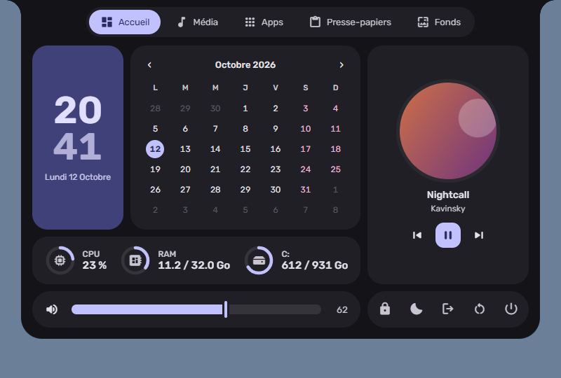
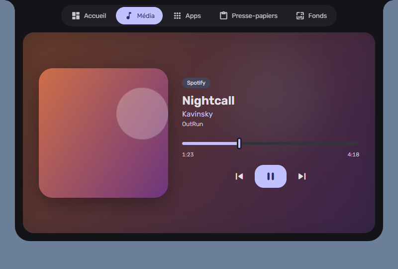
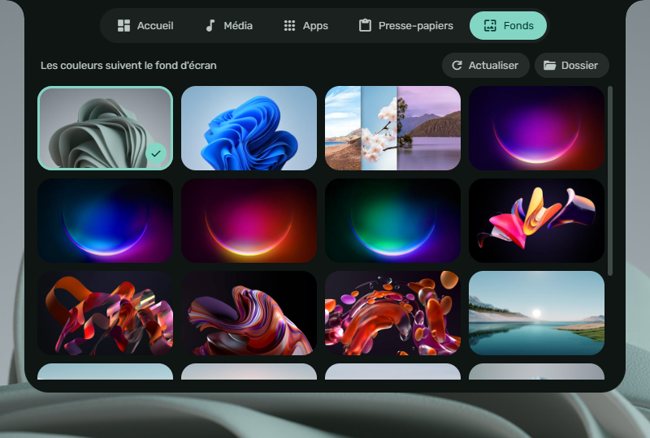
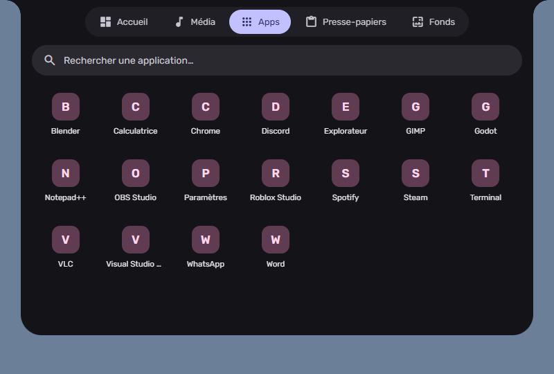

# Caelestia for Windows

**Un îlot façon [caelestia-dots](https://github.com/caelestia-dots/shell), mais pour Windows.**

Une pilule discrète en haut de l'écran, collée au bord comme les tiroirs de
Caelestia. Survolez-la pour voir le morceau en cours, cliquez ou faites défiler
pour ouvrir le panneau. Les couleurs suivent votre fond d'écran (Material You).

> Projet indépendant, non affilié à Caelestia. Aucun code de Caelestia n'est
> repris : seul le style s'en inspire.

<p align="center">
  
  
  
  
</p>

## Fonctionnalités

| Onglet | Contenu |
|---|---|
| **Barre** | Façon Waybar, l'îlot au centre : lanceur, bureaux virtuels (clic ou molette), fenêtres ouvertes, regroupées par appli (clic : activer / réduire ou fenêtre suivante, clic molette : fermer ; au survol, aperçu de chaque fenêtre pour choisir ou fermer), CPU / RAM, Wi-Fi, Bluetooth, volume (molette), batterie, notifications, date. Le haut de l'écran est réservé (les fenêtres maximisées s'arrêtent dessous) et la barre des tâches Windows peut être masquée, sur tous les écrans. Les autres écrans ont aussi leur barre, avec l'heure au centre ; ses boutons ouvrent l'îlot sur son écran. Options : îlots séparés (sans fond, chaque groupe flotte seul), fenêtres ouvertes affichées ou non, masquage automatique (la barre apparaît quand la souris touche le haut de l'écran) |
| **Îlot replié** | Heure ; pochette qui tourne et égaliseur qui suit vraiment le son ; icônes caféine, ne pas déranger et minuteur en cours |
| **Survol** | Titre, artiste, progression, lecture/pause ; sinon date et météo |
| **Accueil** | Profil (avatar Windows, durée d'allumage), météo, horloge, calendrier avec vos agendas iCal (clic sur un jour : ses événements), lecteur avec visualiseur, CPU / RAM / disque / batterie, volume, verrouiller · veille · déconnexion · redémarrer · éteindre (second clic pour confirmer) |
| **Média** | Lecteur complet avec avance dans le morceau et visualiseur audio. Fonctionne avec tout ce que Windows voit (Spotify, navigateurs…) |
| **Contrôles** | Wi-Fi (réseaux, connexion avec mot de passe), Bluetooth, caféine (empêche la veille), ne pas déranger, mode sombre, minuteur / Pomodoro, luminosité, sortie audio, volume par application, centre de notifications |
| **Apps** | Toutes les applis du menu Démarrer avec icônes, recherche, navigation clavier. Préfixes : `>` commandes (fond au hasard, variantes de couleurs, minuteur, Wi-Fi, session…), `=` calculatrice, `:` emoji, `?` recherche web. Un calcul tapé directement s'affiche aussi. **Ctrl+Alt+Espace** ouvre le lanceur, ainsi que la touche Windows seule si le réglage est activé (la touche est alors remappée au niveau du pilote clavier pour que Windows n'ouvre plus le menu Démarrer : droits administrateur et redémarrage requis ; les raccourcis Win+… restent ceux de Windows, Ctrl+Échap ouvre le menu Démarrer). **Dossiers** (clic droit sur une appli, ou glisser une appli sur un dossier), fichiers et raccourcis déposés depuis l'Explorateur, applis masquées (clic droit sur « Toutes » pour les réafficher), tri par nom ou date d'ajout. **Launcher** de jeux : Steam, Epic Games, Ubisoft Connect et GOG avec jaquettes, plus les jeux ajoutés à la main |
| **Mail** | Comptes IMAP (Gmail, Yahoo, iCloud, Orange…) avec mot de passe d'application chiffré (DPAPI), boîte de réception de chaque compte, lecture du message ; nombre de non-lus sur l'onglet et dans la pilule |
| **PC** | Discord : micro, sourdine, volume de chaque personne du salon et de son propre micro (RPC, avec une application Discord à soi ; sinon mélangeur Windows). Logiciels du PC (MSI Center, Armoury Crate, G HUB) et mode d'alimentation de Windows 11 |
| **Tâches** | Gestionnaire des tâches : programmes regroupés avec CPU, mémoire, disque et connexions réseau (colonnes colorées selon la charge), tri, filtre, fin de tâche (processus Windows protégés) |
| **Presse-papiers** | Les 40 derniers textes et images copiés, un clic pour recopier ; bloc-notes enregistré automatiquement |
| **Fonds** | Vos images de `Images\Wallpapers` + celles de Windows ; choisir un fond recalcule la palette. Avec **Wallpaper Engine**, un second onglet liste vos fonds WE. Bouton « Au hasard » |
| **Réglages** (⚙) | Démarrage avec Windows, écran de l'îlot, mode clair / sombre / auto, variante Material You (Tonal Spot, Vibrant, Expressive…), accent et mode appliqués à Windows, ville de la météo, agendas iCal, rotation automatique des fonds, notifications et indicateurs |

La pilule s'agrandit aussi un instant pour signaler :
- un changement de volume ou de luminosité (OSD) ;
- une notification Windows ;
- un appareil Bluetooth connecté ou déconnecté ;
- une image copiée (capture d'écran) ;
- le chargeur branché ou débranché ;
- Verr. Maj ;
- la fin du minuteur.

Autres comportements :
- en haut à droite du panneau : **agrandir** (presque tout l'écran), **verrouiller** (l'îlot reste ouvert quand la souris sort) et **quitter l'îlot** (second clic pour confirmer ; aussi la commande `>quitter` du lanceur) ;
- calendrier : une **note** par jour (clic sur un jour) ;
- Média : **playlists** favorites (liens Spotify, Deezer, YouTube) ;
- Réglages › Apparence : **fond de l'îlot** (et de la barre) opaque, translucide ou fond d'écran flouté ;
- hors de l'îlot, les clics passent aux fenêtres en dessous ;
- l'îlot se cache quand un jeu ou une vidéo est en plein écran ;
- une icône dans la zone de notification permet d'ouvrir les réglages, de recharger ou de quitter.

### Notes techniques

- **Notifications** : l'API officielle exige une appli empaquetée (MSIX). L'îlot lit donc, en lecture seule, la base du centre de notifications (`%LOCALAPPDATA%\Microsoft\Windows\Notifications\wpndatabase.db`). Les notifications Windows doivent être activées. « Effacer » ne les masque que dans l'îlot.
- **Sortie audio** : changée via `IPolicyConfig`, l'interface (non documentée) qu'utilise le panneau Son de Windows.
- **Luminosité** : WMI pour l'écran d'un portable, DDC/CI pour un écran externe (s'il le permet).
- **Visualiseur** : capture « loopback » WASAPI de la sortie par défaut + FFT, uniquement quand de la musique joue.
- **Agenda** : adresse iCal secrète (Google Agenda : Paramètres › Intégrer l'agenda ; Outlook : Publier un calendrier). Les événements récurrents sont gérés.
- **Météo** : [Open-Meteo](https://open-meteo.com), sans clé.
- **Mail** : IMAP en TLS ; les mots de passe sont chiffrés avec DPAPI (déchiffrables seulement par la session Windows) dans `%LOCALAPPDATA%\Ilot\mail.json`.
- **Discord** : RPC local (`\\.\pipe\discord-ipc-0`), avec une application créée sur le portail développeurs Discord (redirection `http://localhost`) ; jetons chiffrés avec DPAPI.
- **Tâches** : `sysinfo` pour CPU / mémoire / disque ; connexions TCP par processus via `GetExtendedTcpTable` (le débit réseau par processus demanderait ETW et des droits administrateur).
- **Dossiers, notes, playlists** : petits fichiers JSON dans `%LOCALAPPDATA%\Ilot`.
- **Accent Windows** : écrit dans le registre (`AccentPalette`, `AccentColor`…) et désactive la couleur automatique de Windows.

## Wallpaper Engine

Si [Wallpaper Engine](https://store.steampowered.com/app/431960/) est installé,
il est détecté automatiquement (toutes les bibliothèques Steam sont parcourues) :

- l'onglet **Fonds** propose « Windows / Wallpaper Engine » et liste vos fonds
  du Workshop, vos projets et ceux fournis avec WE, avec leur aperçu ;
- un clic applique le fond via la commande officielle
  `wallpaper32.exe -control openWallpaper` (écran 0) ;
- quand WE tourne, la palette suit le fond WE affiché, et non le fond Windows
  qu'il recouvre. Si vous changez de fond dans WE, l'îlot se recolore tout seul.

## Installation

Pas encore de version publiée : il faut compiler (voir plus bas). `install.ps1`
compile, copie l'îlot dans `%LOCALAPPDATA%\Programs\Ilot` et l'ajoute au
démarrage.

## Compiler

Prérequis :
- [Rust](https://rustup.rs) (1.89 ou plus) ;
- Visual Studio Build Tools 2022 (MSVC, CMake, Ninja) ;
- Qt 6.9 pour MSVC 2022, avec le module Qt Shader Tools (par exemple avec
  `aqtinstall` : `aqt install-qt windows desktop 6.9.3 win64_msvc2022_64 -m qtshadertools`).

```bat
set QTDIR=C:\Qt\6.9.3\msvc2022_64
qt\build.cmd
```

Le script compile le cœur Rust (`cargo build --release`), puis l'interface
(CMake), et copie les DLL de Qt : `qt\build\ilot.exe` se lance tel quel.

`.cargo/config.toml` demande à Cargo de choisir des versions de dépendances
compatibles avec la toolchain installée.

Options utiles pour travailler l'interface :
- `ilot.exe --open <onglet>` ouvre le panneau au démarrage (`home`, `media`,
  `ctrl`, `apps`, `mail`, `pc`, `tasks`, `clips`, `walls`, `settings`) ;
- `ILOT_QT_LOG=<fichier>` écrit les messages de Qt et du QML dans un fichier ;
- `ILOT_QT_SHOT=<fichier.png>` capture la fenêtre de l'îlot après
  `ILOT_QT_SHOT_DELAY` ms (4000 par défaut), puis quitte si `ILOT_QT_SHOT_QUIT` est défini.

`ilot.exe --check-all rapport.txt` écrit un diagnostic des modules système (audio, réseau,
notifications, visualiseur, HTTP) sans lancer l'interface.

## Comment ça marche

- **Deux parties** : le cœur en Rust (`src/`, compilé en `ilot_core.dll`) parle
  à Windows ; l'interface est en Qt Quick / QML (`qt/`). L'interface appelle les
  commandes du cœur (`ilot_invoke`, sur un thread à part) et reçoit ses
  événements ; les images (icônes, pochettes, fonds) passent par
  `image://ilot/…` sans copie en base64.
- **Fenêtre** : transparente, toujours au premier plan. Un masque de fenêtre
  limite la souris aux zones de l'îlot et de la barre : ailleurs, les clics
  passent aux fenêtres dessous.
- **Média** : `GlobalSystemMediaTransportControls` (WinRT), suivi par événements.
- **Barre** : zone réservée via `SHAppBarMessage` (AppBar) ; bureaux virtuels lus dans le registre (`VirtualDesktopIDs`), changés par Ctrl+Win+←/→ faute d'API publique. Sur les autres écrans, une fenêtre par écran (`qt/qml/Bar.qml`) partage l'état et le thème de l'îlot. La barre des tâches Windows (principale et secondaires) est passée en masquage automatique puis cachée, et tout est rétabli en quittant l'îlot (si l'îlot plante, redémarrer l'Explorateur la fait revenir).
- **Volume** : Core Audio (`IAudioEndpointVolume`).
- **Apps** : dossier virtuel `shell:AppsFolder`, icônes via `IShellItemImageFactory`.
- **Wallpaper Engine** : lecture de `config.json` et des `project.json`, application via sa ligne de commande.
- **Fonds** : `IDesktopWallpaper`, miniatures mises en cache dans `%LOCALAPPDATA%\Ilot\thumbs`.
- **Couleurs** : [material-color-utilities](https://github.com/material-foundation/material-color-utilities),
  schéma *Tonal Spot* sombre par défaut, calculé à partir du fond d'écran ; la
  palette s'anime lors d'un changement.

## Composants tiers

- Qt 6 (Qt Quick, Qt Quick Shapes, Qt Quick Effects) — LGPL v3, © The Qt Company
- material-color-utilities (`qt/qml/mcu.mjs`) — Apache 2.0, © Google
- Material Symbols Rounded (sous-ensemble, `qt/fonts`) — Apache 2.0, © Google
- Rubik (`qt/fonts`) — SIL Open Font License 1.1

## Licence

MIT — voir [LICENSE](LICENSE).
